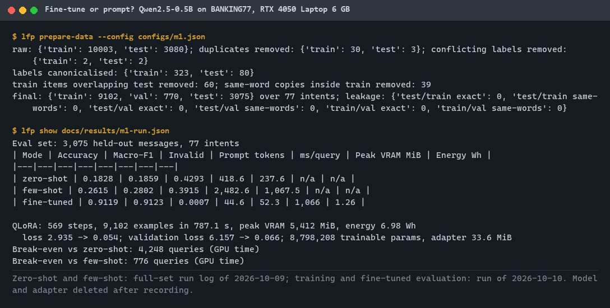
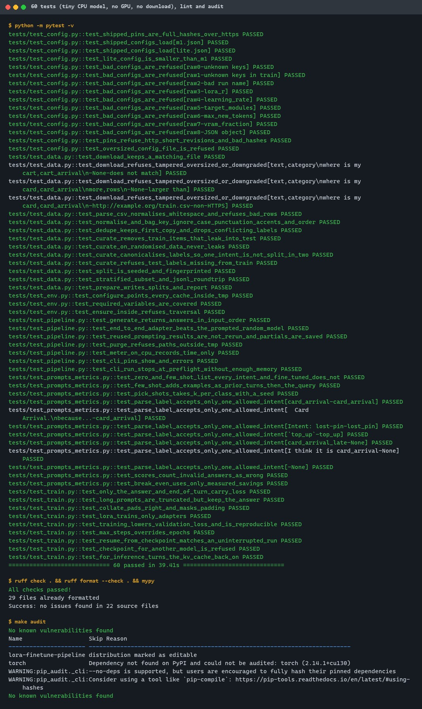
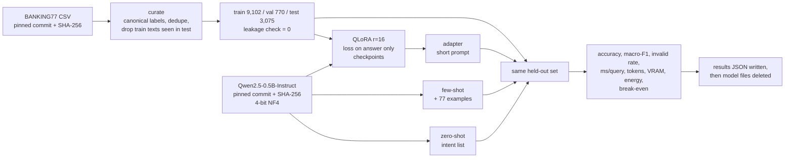
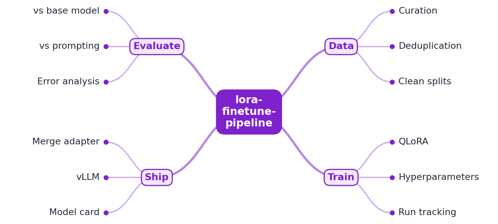

# lora-finetune-pipeline

[](https://github.com/EquinoxWN/lora-finetune-pipeline/actions/workflows/ci.yml)


> Answers 'should we fine-tune or just prompt?' with a real, costed comparison instead of a guess: on BANKING77, a 13-minute QLoRA run on a 6 GB laptop GPU takes a 0.5B model from 26% (few-shot) to 91% accuracy, with answers 20 times faster.

Part of my **AI and Machine Learning** list · Python

## Proof it works

Qwen2.5-0.5B-Instruct in 4-bit, scored on the same 3,075 held-out banking messages (77 intents):
prompted zero-shot it reaches 18.3%, with one example per intent 26.2%, and with a QLoRA adapter
trained for 13.1 minutes on an RTX 4050 Laptop GPU 91.2%. The adapter also answers in 52 ms
instead of 1,068 ms, so the training run is repaid after 776 queries:



60 tests pass on a tiny random model on the CPU (no GPU, no download), lint and strict types are
clean, and the dependency audit finds no known vulnerabilities:



## Architecture

**What M1 runs today:**



**Full roadmap (M1 to M3):**



## How it works

_Steps 1, 2 and 4 are built and measured; the rest is on the [roadmap](#roadmap)._

1. A task dataset is curated, de-duplicated and split with no leakage.
2. QLoRA trains small adapters on a quantized base model on a single GPU.
3. Every run is tracked with its config, metrics and artifacts.
4. The tuned model is compared with the base model and a few-shot prompt on the same held-out set.
5. Error analysis groups the remaining mistakes.
6. The adapter is served with vLLM and documented in a model card, including costs.

## Who it helps

- **Who:** ML and platform engineers who have to ship a narrow language task (routing, tagging, intent detection) and must choose between prompting a general model and fine-tuning one.
- **The problem:** the choice is usually made on intuition, while accuracy, invalid answers and cost per query can all be measured.
- **How to use it:** run `make run` (or `make run-lite`) on one GPU; it scores zero-shot, few-shot and a QLoRA adapter on the same leakage-checked held-out set and writes accuracy, latency, tokens, VRAM, energy and the break-even point to one JSON file. To run the same comparison on your own task, point the dataset pin in `config.py` at a `text,category` CSV with its SHA-256 (and change the base model pin if you have a larger GPU).

## Tech stack

| Area | In M1 | Planned |
|---|---|---|
| Core | PyTorch 2.14 (CUDA 13.0), Transformers 5, PEFT LoRA, bitsandbytes NF4 (QLoRA), explicit training loop with checkpoints | TRL if the project grows to multi-GPU |
| Data | BANKING77 (CC BY 4.0), pinned commit and SHA-256, curation and leakage check | more tasks |
| Model | Qwen2.5-0.5B-Instruct (Apache-2.0), pinned commit and SHA-256 | larger base models on bigger GPUs |
| Evaluation | zero-shot, few-shot and adapter on one held-out set; NVML energy, peak VRAM, break-even | retrieved few-shot examples, error analysis |
| Tracking / ship | results JSON per run | MLflow, merged adapter on vLLM, model card |

Language: **Python** (3.11+; the recorded run used 3.14, CI uses 3.12). Code in [`src/lora_finetune_pipeline/`](src/lora_finetune_pipeline): `data.py` (verified download, curation, split), `prompts.py`, `train.py` (masked features, LoRA, loop, checkpoints), `evaluate.py`, `metrics.py`, `cost.py`, `gpu.py` (time, VRAM, energy, preflight), `model.py`, `pipeline.py`, `cli.py`, `env.py` (every cache inside `.tmp`).

## Run it

**Prerequisites:** Python 3.11+. The tests need only a CPU. The comparison needs an NVIDIA GPU with about 4 GB of free VRAM and about 1.5 GB of free RAM after PyTorch has started (checked before loading).

```bash
python -m venv .venv && source .venv/bin/activate   # Windows: .venv\Scripts\activate
make setup       # CPU PyTorch, the package and dev tools
make lint        # ruff, ruff format, mypy --strict
make test        # 60 tests on a tiny random model, no GPU, no download

make setup-gpu   # CUDA 13.0 PyTorch, bitsandbytes, accelerate, nvidia-ml-py
make data        # download BANKING77 (SHA-256 checked), curate, split, check leakage
make run         # full comparison, about 85 minutes on an RTX 4050 Laptop; writes docs/results/m1-run.json
make run-lite    # 385 held-out messages and 150 steps, about 12 minutes
make purge       # delete anything left in .tmp, including the dataset
```

`make run` deletes the base model and the adapter itself once the results JSON is written. Every
cache (Hugging Face, torch, Triton, CUDA, temp) stays in the git-ignored `.tmp/` folder. If a run
stops, rerunning resumes training from the last checkpoint, and `--reuse <results.json>` skips
prompting phases that were already recorded.

## Tests and results

Full numbers, the analysis and the deleted files: [docs/results/m1.md](docs/results/m1.md). The GPU
comparison was run locally on the RTX 4050; CI runs the tests only.

| Check | Result |
|---|---|
| Tests (`make test`) | **60 passed**, 0 failed (twice) |
| Leakage between train, validation and test | **0** exact and 0 same-word overlaps |
| Accuracy on 3,075 held-out messages | zero-shot 0.183, few-shot 0.262, **QLoRA adapter 0.912** |
| Answers naming no allowed intent | 42.9%, 39.2%, **0.07%** |
| Time per query (batch 16) | 237.6 ms, 1,067.5 ms, **52.3 ms** |
| Prompt tokens per query | 418.6, 2,482.6, **44.6** |
| QLoRA training | 569 steps in 787.1 s, 5,412 MiB peak VRAM, 6.98 Wh; validation loss 6.157 -> 0.066 |
| Break-even of training | 776 queries vs few-shot, 4,248 vs zero-shot (GPU time) |
| Lint / audit | ruff, mypy `--strict` clean; `pip-audit`: no known vulnerabilities |

| Test file | Tests | What it proves |
|---|---|---|
| `test_config.py` | 15 | Pins are full hashes over HTTPS; configs load; bad keys, names, ranges, URLs and oversized files are refused |
| `test_data.py` | 14 | Downloads are size- and hash-checked with no partial file; parsing, label canonicalisation, normalisation, de-duplication; no leakage on planted and 20 randomised datasets; seeded, fingerprinted split |
| `test_env.py` | 3 | Every cache variable points inside `.tmp`; paths outside are refused |
| `test_prompts_metrics.py` | 12 | Prompt contents per mode; strict answer parser (7 cases); accuracy, macro-F1, invalid rate; break-even arithmetic |
| `test_train.py` | 9 | Loss only on the answer; truncation and padding; only LoRA trains; reproducible training; resume equals an uninterrupted run; KV cache restored after training |
| `test_pipeline.py` | 7 | Ordered batched generation; end to end on CPU the adapter beats prompting; reuse of recorded results; purge confined to `.tmp`; CLI exit codes 2 and 3 |

## Roadmap

**M1** (≈8 h)
- [x] Write `docs/rfc/0001-design.md`: problem, goals, non-goals, chosen design
- [x] A task dataset is curated, de-duplicated and split with no leakage.
- [x] QLoRA trains small adapters on a quantized base model on a single GPU.

**M2** (≈8 h)
- [ ] Every run is tracked with its config, metrics and artifacts.
- [x] The tuned model is compared with the base model and a few-shot prompt on the same held-out set.

**M3** (≈9 h)
- [ ] Error analysis groups the remaining mistakes.
- [ ] The adapter is served with vLLM and documented in a model card, including costs.
- [ ] Publish the proof below with real numbers

## Proof

What this repo must show before it counts as done:

- A table of quality, latency and cost for base vs prompting vs fine-tuned.

| Result | Value |
|---|---|
| Quality, latency and cost table | Measured in M1 for one task and one model, see [Tests and results](#tests-and-results); serving costs with vLLM are M3. |

## Why it matters

- **Interview angle:** 'When would you fine-tune vs prompt vs use RAG?'
- **Upstream I'm contributing to:** Hugging Face PEFT or TRL.

## Design docs

- [RFC 0001: design](docs/rfc/0001-design.md)
- [ADR 0001: record architecture decisions](docs/adr/0001-record-architecture-decisions.md)
- [ADR 0002: an explicit QLoRA training loop instead of TRL](docs/adr/0002-explicit-training-loop-instead-of-trl.md)
- [ADR 0003: a 0.5B 4-bit base model, a memory preflight, models deleted after each run](docs/adr/0003-small-4bit-base-model-and-delete-after-run.md)
- [M1 results](docs/results/m1.md)

## Scope

This is a learning and portfolio system, not a hosted production service. Everything runs locally.
The result describes one task (77-way intent detection) and one 0.5B base model; larger models
prompt better.

## Security and contributing

- Every GitHub Action is pinned to a commit SHA; workflows run read-only, without persisted credentials.
- Dependabot update pull requests are paused (`open-pull-requests-limit: 0`) so the repository keeps a single `main` branch; dependencies are updated by hand and checked by the CI audit.
- The dataset and the model are pinned by commit and SHA-256 and fetched over HTTPS only; weights load from `safetensors`, and checkpoints load with `weights_only=True`; configs are schema-checked and every output or delete path is confined to `.tmp`; CI runs `pip-audit` on every push.
- Report vulnerabilities privately: see [SECURITY.md](SECURITY.md). To contribute, see [CONTRIBUTING.md](CONTRIBUTING.md).

## License

MIT, see [LICENSE](LICENSE). BANKING77 is CC BY 4.0 (Casanueva et al., 2020); Qwen2.5-0.5B-Instruct is Apache-2.0. Neither is redistributed here.
